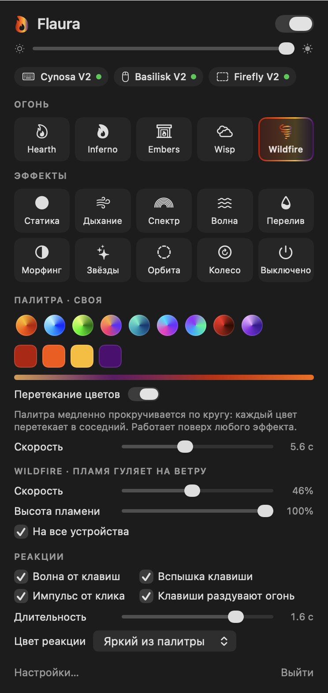

# Flaura

[Русский](README.md) · **English**

Flaura is a lightweight macOS menu bar app that drives Razer RGB lighting instead of Synapse.
Live fire is the main act, but calmer effects are there too. Every device is rendered from one
timer, so the keyboard, mouse and mat glow in sync and share one palette.

The name is flame + aura, and it sounds almost like "flora": lighting as something alive.

The interface is in Russian; the labels this guide refers to are given with a translation.

<p align="center"></p>

## Who it is for

- You have a Mac and Razer peripherals, and Synapse will not install on macOS or does not see
  your devices.
- You want the keyboard, mouse and mat to light up as one, not each on its own.
- You do not want heavy background software: Flaura lives in the menu bar, uses about 35 MB of
  memory and needs no drivers or kernel extensions.

Works out of the box with the **Razer Cynosa V2**, **Basilisk V2** and **Firefly V2**, tested on
a MacBook M2 Pro with macOS 26.6. Other Razer devices with an extended matrix can be described
in a JSON file without rebuilding (see [Adding a device](#adding-a-device)). Requires macOS 14
or later.

## Features

- **Fire** («Огонь»), five kinds:
  - Hearth: a classic fireplace.
  - Inferno: tall flames with a white core.
  - Embers: glowing coals and sparks.
  - Wisp: a soft, ghostly fire.
  - Wildfire: flames blown by the wind.
- **Effects**: static, breathing, spectrum, wave, flow, morph, starlight, orbit, wheel.
- **Palette** of up to four colors, shared by all devices. Nine presets plus your own colors:
  "+" adds a random vivid color unlike the ones already there, and clicking a color opens an
  editor (hue, saturation, brightness, hex, «Случайный» / Random, «Удалить» / Delete).
  «Перетекание цветов» (color flow) slowly rotates the palette on top of any effect: each color
  glides into its neighbour, and the strip under the colors shows it live.
- **Reactions**:
  - a ripple spreads from the pressed key, optionally across all devices;
  - the pressed key flashes;
  - a mouse click sends a pulse across the mat;
  - typing stokes the fire.
- Per device: on/off, its own brightness, its own effect. The palette stays shared.
- The lighting follows the display: it stays on while the screen is on, including the lock
  screen and the login window, and goes dark only when the display sleeps. When Flaura quits,
  the devices store a static palette color, so on the next power-on the keyboard is already lit
  on the FileVault screen, before macOS starts.

## Installation

There is no prebuilt release: the app is built on your Mac with one command. Xcode is not
needed, the Command Line Tools are enough.

1. Install the Command Line Tools if you do not have them yet:

   ```bash
   xcode-select --install
   ```

2. Clone the repository and run the installer:

   ```bash
   git clone https://github.com/mrzenxxx/flaura.git
   cd flaura
   scripts/install.sh
   ```

   The script builds `build/Flaura.app`, copies it to `~/Applications` and launches it. A flame
   appears in the menu bar.

3. For key and click reactions, press «Разрешить…» (Allow…) in the panel and turn Flaura on in
   System Settings → Privacy & Security → Input Monitoring. The lighting itself needs no
   permissions.

On the first build the script creates a local code-signing certificate, "Aura Local Signing",
in your login keychain. It lets macOS recognise the app after a rebuild, so the Input Monitoring
permission is not reset. If macOS asks whether `codesign` may use the key, choose "Always
Allow". To skip the certificate, run `scripts/install.sh --adhoc`, but then the permission has
to be granted again after every update.

Flaura adds itself to login items and checks on every launch that it is still there. Turn it
off in Flaura's settings or in System Settings → General → Login Items.

**Updating:** `git pull && scripts/install.sh`.

**Removing:** quit Flaura (panel → «Выйти» / Quit), then

```bash
rm -rf ~/Applications/Flaura.app "$HOME/Library/Application Support/Aura"
```

The settings folder is named `Aura` after the app's former name. The certificate can be deleted
in Keychain Access (`Aura Local Signing`).

## How it works

The code modules kept their original names (`AuraCore`, `AuraDevices`…); the app and the
binaries are called Flaura.

```
AuraUSB      C bridge to IOUSBLib: USB control transfers on the default pipe
AuraDevices  device providers: RazerProvider (hot-plug, protocol, layouts)
AuraCore     engine without IOKit: palettes, effects, layers, compositor, render loop
AuraApp      the menu bar app (AppKit + SwiftUI)
aura-cli     hardware diagnostics (the flaura-cli binary)
```

- **No permissions.** macOS requires Input Monitoring to open a mouse or keyboard HID
  interface. Flaura sends Razer reports as plain USB control transfers (SET_REPORT/GET_REPORT,
  90 bytes), so the lighting works without TCC.
- **In sync.** Every frame is computed on the Mac and sent to all devices. Each device has its
  own "last frame wins" queue, so a slow device does not hold back the others.
- **Light.** Only changed matrix rows are sent. On static effects the timer stops. During sleep
  rendering is paused. While animating, App Nap is disabled, otherwise the timer gets throttled.
  Fire on three devices at 30 FPS takes about 3–4% of one core, almost all of it the kernel
  doing USB. About 35 MB of memory.

### Adding a device

Any RGB device plugs in through the `DeviceProvider` / `LightingDevice` protocols in
`AuraCore`. A device describes its LEDs as data (`DeviceLayout`: positions in mm, slots, key
codes), and effects only work with those points. A new vendor, be it the OpenRGB SDK, HID
LampArray or Corsair, means a new provider in `DeviceRegistry.standardProviders`.

Other Razer devices with an extended matrix can be added without rebuilding: put a JSON file in
`~/Library/Application Support/Aura/devices/`:

```json
{"productID": 133, "name": "Razer Basilisk V2", "kind": "mouse", "rows": 1, "columns": 2,
 "transactionID": 31, "controlIndex": 0, "ledIDs": [1, 4], "driverMode": false, "layoutStyle": "mouse"}
```

The values come from OpenRazer (`daemon/openrazer_daemon/hardware/*.py`, `driver/*.c`).

## Development

```bash
scripts/test.sh                     # tests (Swift Testing from the CLT)
swift build --product flaura-cli
.build/debug/flaura-cli list        # devices
.build/debug/flaura-cli pattern     # test pattern for checking a layout
.build/debug/flaura-cli run hearth 15 --typing   # an effect without the UI + CPU measurement
.build/debug/flaura-cli bench       # frame write timing
.build/debug/Flaura --snapshot /tmp/flaura-ui    # render the UI to PNGs
.build/debug/Flaura --selftest                   # AppModel smoke test: hundreds of random settings changes
```

The spec and the plan are in `docs/superpowers/` (in Russian).

## Acknowledgements

The Razer protocol is based on the sources of [OpenRazer](https://github.com/openrazer/openrazer),
[OpenRGB](https://gitlab.com/CalcProgrammer1/OpenRGB) and
[librazermacos](https://github.com/1kc/librazermacos). The Firefly V2 LED order comes from
SignalRGB and was checked on the hardware.

## License

[MIT](LICENSE).
